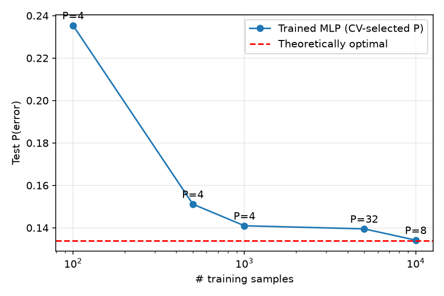
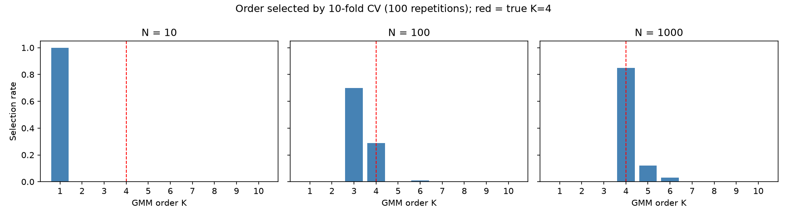
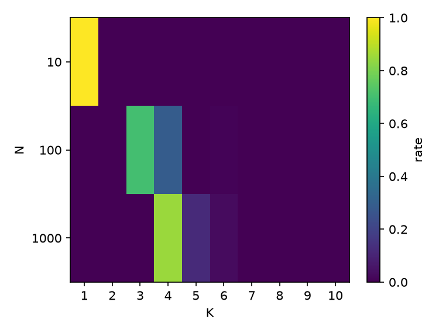

Jae Young Seo

### [My code](https://github.com/Jae-YS/EECE5644_Assignment3)

Code files: `q1_mlp_classifier.py` (Question 1), `q2_gmm_order_selection.py` (Question 2)

I used Claude (Sonnet 5.5, Anthropic) as an AI assistant on this assignment. Specifically, for visualization, data generation, and classifer layout. It also helped with the structure and wording of the written report and its tables.

---

## Question 1: MLP Approximation of Class Posteriors and MAP Classification

### 1.1 Data distribution

Four classes with uniform priors (P(c) = 0.25) generate 3-D real-valued data from Gaussian class-conditional densities N(μ_c, Σ_c).

| Class | Mean μ_c | Covariance Σ_c |
|---|---|---|
| 1 | [0, 0, 0] | [[1.0, 0.3, 0], [0.3, 1.0, 0.2], [0, 0.2, 1.0]] |
| 2 | [3, 0, 0] | [[1.5, −0.4, 0], [−0.4, 1.0, 0], [0, 0, 1.2]] |
| 3 | [0, 3, 0] | [[1.0, 0, 0.3], [0, 1.6, 0.3], [0.3, 0.3, 1.0]] |
| 4 | [1.5, 1.5, 3] | [[1.2, 0.2, 0.2], [0.2, 1.2, −0.3], [0.2, −0.3, 1.5]] |

The means were chosen so that the classes overlap moderately. The code includes an automatic adjustment that rescales the mean separation until the optimal error falls in the 10–20% target range. The initial scale of 1.0 already satisfied the target, so no rescaling was applied.

Datasets: training sets of 100, 500, 1000, 5000 and 10000 samples, and one test set of 100000 samples. The test set was used only for final evaluation.

### 1.2 Theoretically optimal classifier

With uniform priors and 0-1 loss, the minimum-probability-of-error rule is the MAP rule, which reduces to choosing the class with the largest true class-conditional pdf: ĉ(x) = argmax_c p(x | c). Applying this rule to the test set gives

**Optimal test P(error) = 0.1339**

This is inside the required 10–20% range and serves as the aspirational performance level for the MLPs.

### 1.3 MLP structure and training

- **Architecture:** 3 inputs → hidden layer with P perceptrons (ELU activation, a smooth-ramp function) → 4 outputs with softmax, so outputs are positive and sum to 1.
- **Training objective:** average cross-entropy, which is equivalent to maximum likelihood estimation of the class posteriors. A very small L2 term (10⁻⁵) was added for numerical stability.
- **Optimizer:** L-BFGS (scipy) using analytic gradients from a hand-written backward pass.
- **Local optima:** Final models used 5 random restarts (weights drawn from N(0, 0.5²)). The solution with the lowest training cross-entropy, i.e. the highest training log-likelihood, was kept.
- **Decision rule:** Each trained MLP is used as a posterior model and classifies test samples by argmax over its outputs (MAP rule).

### 1.4 Verifying the software does what is intended

- **Gradient check:** The analytic gradient was compared against finite differences for a random network and data batch. The maximum absolute difference was 2.2×10⁻⁷, confirming that the backward pass is correct.
- **Bayes classifier:** It is built from the exact densities (scipy `multivariate_normal`) of the same distribution used to generate the data, with equal priors, so it is a direct argmax over the pdfs.
- **Softmax stability:** Logits are shifted by their maximum before exponentiation to avoid overflow.
- **Data hygiene:** Cross-validation is run only on training data. The test set is generated separately and used only once per final model.

### 1.5 Model order selection by cross-validation

For each training set size, 10-fold cross-validation was run over P ∈ {1, 2, 4, 8, 16, 32, 64}. The objective was the average validation misclassification rate. Each CV fit used one random initialization to keep computation manageable. The selected P is the one with the lowest mean validation error.

Mean 10-fold CV P(error) for each candidate:

| N \ P | 1 | 2 | 4 | 8 | 16 | 32 | 64 |
|---|---|---|---|---|---|---|---|
| 100 | 0.430 | 0.220 | **0.150** | 0.190 | 0.170 | 0.160 | 0.150 |
| 500 | 0.478 | 0.198 | **0.150** | 0.154 | 0.190 | 0.178 | 0.198 |
| 1000 | 0.365 | 0.197 | **0.135** | 0.147 | 0.156 | 0.160 | 0.177 |
| 5000 | 0.392 | 0.180 | 0.141 | 0.142 | 0.142 | **0.140** | 0.140 |
| 10000 | 0.379 | 0.180 | 0.136 | **0.135** | 0.136 | 0.137 | 0.138 |

At N = 100, P = 4 and P = 64 are tied at 0.150, and the first minimum (P = 4) was selected.

### 1.6 Results

| N (training samples) | Selected P | CV P(error) | Test P(error) | Gap to optimal |
|---|---|---|---|---|
| 100 | 4 | 0.150 | 0.2354 | +0.1015 |
| 500 | 4 | 0.150 | 0.1512 | +0.0173 |
| 1000 | 4 | 0.135 | 0.1410 | +0.0071 |
| 5000 | 32 | 0.140 | 0.1395 | +0.0056 |
| 10000 | 8 | 0.135 | 0.1342 | +0.0003 |
| *Optimal (true pdf)* | n/a | n/a | *0.1339* | n/a |

*Figure 1. Test P(error) of the CV-selected MLPs versus training set size (semilog-x). The dashed red line is the empirical test P(error) of the theoretically optimal classifier. Labels give the selected P.*

### 1.7 Discussion

**Convergence to the optimum.** Test error decreases as the training set grows and approaches the optimal classifier's error. With 10000 samples the MLP reaches 0.1342 versus 0.1339 for the optimal rule. The test set has 100000 samples, so the standard error of each estimate is about √(0.134 × 0.866 / 10⁵) ≈ 0.0011. The N = 10000 result is therefore statistically indistinguishable from the optimum. The N = 1000 and 5000 results are a few standard errors above it, and N = 100 and 500 are clearly worse.

**Effect of limited data.** At N = 100, the test error (0.235) is much higher than the CV estimate (0.150). Two effects contribute. First, each validation fold contains only 10 samples, so each CV estimate is very noisy, and taking the minimum over seven candidates makes the winning estimate optimistically biased. Second, a network trained on 100 samples has high variance. Even P = 4 has 31 parameters, which is a lot for this amount of data. This is the regime where the model order that CV considers "justified" is still too flexible, so the final model overfits.

**Model order.** P = 1 performs poorly at every N (CV error 0.37–0.48), since a single hidden unit cannot separate four classes in 3-D. P = 2 is much better but still has noticeably higher error (0.18–0.22). From P = 4 onward, the CV error is nearly flat. The true class-conditional densities are Gaussian with simple, smooth decision boundaries, so a small network is sufficient and additional capacity gives no benefit. Larger P is sometimes slightly worse for small N, consistent with overfitting (for example N = 1000: 0.135 at P = 4 versus 0.177 at P = 64).

**Why the selected P is not monotone in N.** The selected values (4, 4, 4, 32, 8) do not increase steadily with N. For N = 5000 and 10000, the CV errors for P between 4 and 64 differ by at most 0.003 (N = 10000) and 0.002 (N = 5000), which is within the noise of a 10-fold estimate. The argmin among these nearly equivalent models is therefore effectively arbitrary. The practical conclusion is that any P in the flat region performs equally well. A more principled tie-breaking rule is to choose the smallest P within one standard error of the minimum (the one-standard-error rule), which would favor smaller networks when the CV curve is this flat.

**Limitations.** Results come from a single random training set at each N, so the curve is one realization. Part of the irregularity (for example the small gap between N = 1000 and 5000) reflects sampling variability. Repeating each experiment over several independent training sets and plotting means with error bars would give a more reliable curve.

---

## Question 2: GMM Model Order Selection with 10-Fold Cross-Validation

### 2.1 True data distribution

Data are drawn from a 2-D Gaussian mixture with four components:

| Component | Weight α | Mean μ | Covariance Σ | Eigenvalues of Σ |
|---|---|---|---|---|
| 1 | 0.30 | [0, 0] | [[2.0, 0.8], [0.8, 1.5]] | 0.91, 2.59 |
| 2 | 0.30 | [2, 1] | [[1.5, −0.6], [−0.6, 2.0]] | 1.10, 2.40 |
| 3 | 0.20 | [−5, 5] | [[1.0, 0], [0, 2.5]] | 1.00, 2.50 |
| 4 | 0.20 | [6, −4] | [[2.5, 1.0], [1.0, 1.0]] | 0.50, 3.00 |

Components 1 and 2 overlap significantly by design. The distance between their means is ‖μ₁ − μ₂‖ = 2.24, which is comparable to the sum of the average eigenvalues of their covariances (about 1.75 + 1.75 = 3.5). Components 3 and 4 are well separated from the rest, so the true number of components is K = 4, but the 1–2 pair is hard to distinguish at small sample sizes.

### 2.2 Procedure

1. **Data:** For each N ∈ {10, 100, 1000}, draw N i.i.d. samples from the true GMM.
2. **Cross-validation:** Split the data randomly into 10 folds (for N = 10 this is leave-one-out). For each candidate order K = 1, …, 10 and each fold, fit a K-component, full-covariance GMM on the other nine folds with EM (maximum likelihood), then compute the log-likelihood of the held-out fold under the fitted model.
3. **Score:** The CV score for order K is the total validation log-likelihood over all folds divided by N. The selected order is the K with the highest score.
4. **Repetition:** Steps 1–3 were repeated **100 times** for each N, each time with a fresh dataset and fresh fold assignment. The selection rate of each K is the fraction of repetitions in which it was chosen.

Implementation details:
- scikit-learn `GaussianMixture`, `covariance_type="full"`, 2 EM initializations per fit (the one with the best training likelihood is kept), maximum 200 iterations.
- A small covariance regularizer (`reg_covar = 1e-3`) prevents singular covariances when a component collapses onto very few points. It is applied at every N and every K.
- If a training fold contains fewer samples than K, the GMM cannot be fit, and that K is assigned a score of −∞ (never selected). This only occurs at N = 10, where each training fold has 9 samples and K = 10 is infeasible.

### 2.3 Results

Selection rate (%) of each GMM order over 100 repetitions:

| N \ K | 1 | 2 | 3 | 4 | 5 | 6 | 7 | 8 | 9 | 10 |
|---|---|---|---|---|---|---|---|---|---|---|
| 10 | **100** | 0 | 0 | 0 | 0 | 0 | 0 | 0 | 0 | 0 |
| 100 | 0 | 0 | **70** | 29 | 0 | 1 | 0 | 0 | 0 | 0 |
| 1000 | 0 | 0 | 0 | **85** | 12 | 3 | 0 | 0 | 0 | 0 |

*Figure 2. Rate at which each GMM order is selected by 10-fold CV, for each dataset size (100 repetitions each). The red dashed line marks the true order K = 4.*

*Figure 3. Heatmap of selection rates (rows: N; columns: K).*

With 100 repetitions, the standard error of an estimated rate p is √(p(1−p)/100), at most 0.05. Differences of a few percentage points between neighboring orders should therefore not be over-interpreted, but the dominant choices at each N (100%, 70%, 85%) are clearly beyond sampling noise.

### 2.4 Discussion

**N = 10: always K = 1.** With only 10 samples, each training fold has 9 points, and each validation fold has a single point. Any model with more than one component has too many parameters for 9 points and generalizes worse than a single Gaussian, so the simplest model wins every time. The result shows that with very little data, cross-validation correctly refuses to support complex models, even though the true order is 4.

**N = 100: usually K = 3, sometimes K = 4.** This is where the overlap between components 1 and 2 matters. With 100 samples (about 30 from each overlapping component), the data do not provide enough evidence to separate them, so a single Gaussian is the better description of that pair, and the best model uses 3 components (one for the merged pair, plus one each for components 3 and 4). In 29% of the repetitions, the sample happened to be informative enough to justify the full 4 components. This is the bias-variance trade-off in action: the 3-component model has slightly higher bias but substantially lower variance, so it validates better.

**N = 1000: K = 4 in 85% of repetitions.** With about 300 samples per overlapping component, the two Gaussians can be separated reliably, and the true order is recovered in most runs. The remaining selections are mostly K = 5 (12%) and K = 6 (3%), which reflect slight overfitting, where an extra component captures sampling fluctuation. Orders below 4 are never selected, and orders above 6 never occur.

**Overall trend.** The selected order increases with the amount of data (1 → 3 → 4), approaching the true order of 4 as N grows. The orders that are "justified by the data" are generally at or below the true order for small N, because the validation log-likelihood penalizes extra parameters that cannot be estimated reliably. Over-selection (K > 4) appears only at N = 1000, and it is limited in extent.

### 2.5 Limitations

- Rates are estimated from 100 repetitions, so each has an uncertainty of up to about 5 percentage points.
- Results depend on the specific overlap chosen between components 1 and 2. A larger separation would shift the N = 100 results toward K = 4.
- EM can converge to local optima. Using two initializations per fit reduces this problem but does not eliminate it.
- The regularizer and the exclusion of infeasible K at N = 10 are implementation choices that affect the smallest-sample results.
